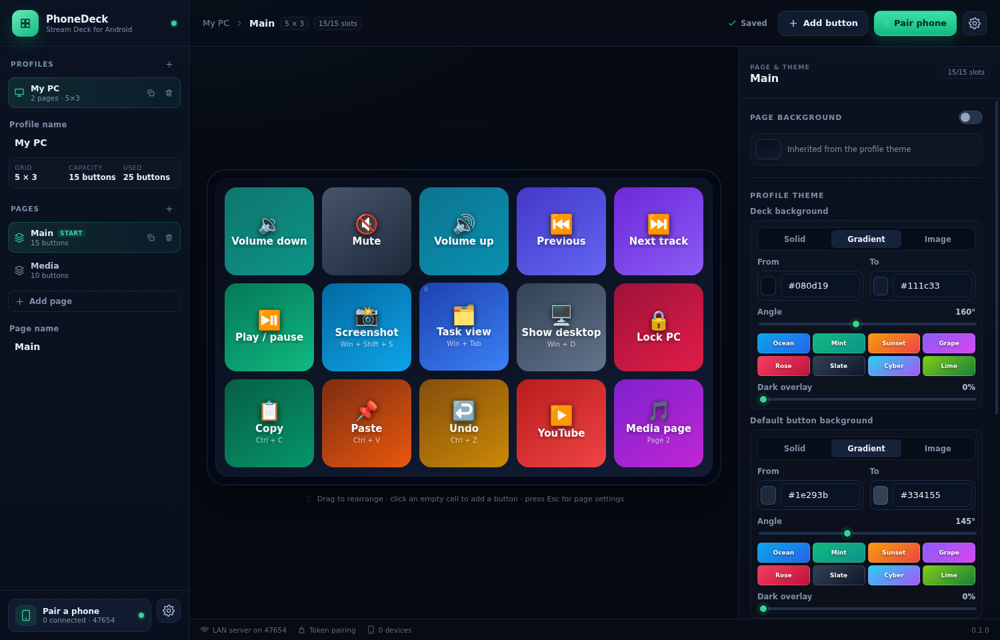
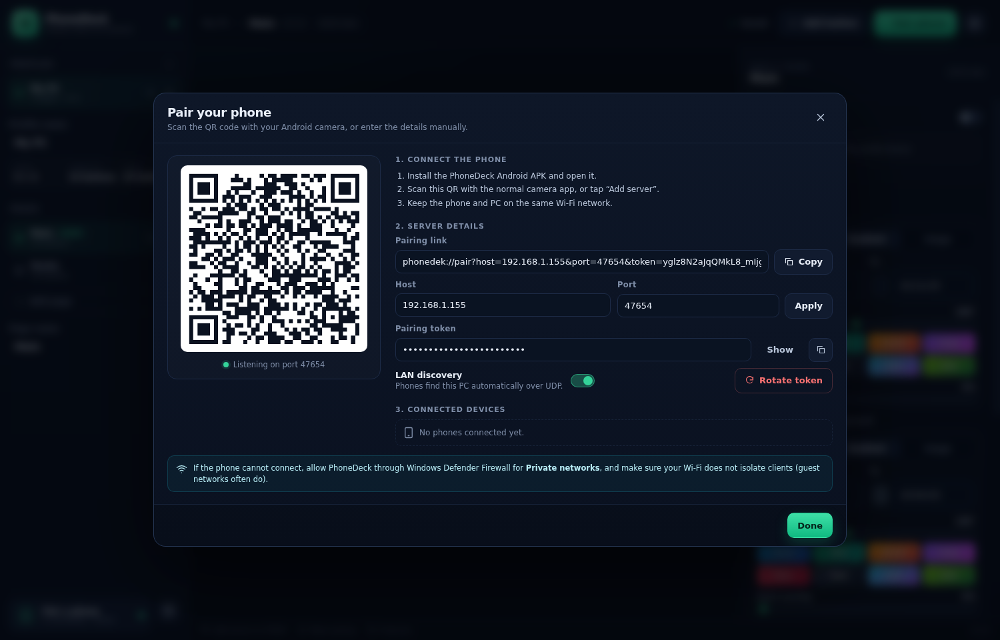

# PhoneDeck

**Turn an Android phone into a wireless Stream Deck for your Windows PC.**

PhoneDeck is two apps that work together:

| App | Platform | What it does |
| --- | --- | --- |
| **PhoneDeck Desktop** | Windows (Electron) | Owns the configuration, hosts a LAN server, records macros, and executes shortcuts/app launches/commands on the PC. |
| **PhoneDeck Android** | Android 8+ (Kotlin/Compose) | Renders the deck fullscreen, pairs over Wi-Fi, sends presses, and handles page navigation instantly. |

No cloud, no account, no vendor lock-in: the phone talks directly to your PC over the local network.



<p align="center"></p>

```
┌──────────────────────────┐        Wi-Fi / LAN         ┌──────────────────────────┐
│  Android phone           │  HTTP config + WebSocket   │  Windows PC              │
│  - fullscreen deck       │ ◄────────────────────────► │  - deck editor           │
│  - QR pairing            │      button presses        │  - macro recorder        │
│  - offline config cache  │                            │  - action executor       │
└──────────────────────────┘                            └──────────────────────────┘
                                                                  │
                                                     SendInput / app launch /
                                                     URL / shell command
                                                                  ▼
                                                            Windows apps
```

## Features

### Deck editor

- **Profiles and pages** — multiple PCs/layouts, unlimited pages per profile, instant page switching.
- **Any grid you want** — 1×1 to 10×10 cells; buttons snap to slots; drag to rearrange or swap.
- **Buttons** — label, sublabel, emoji icon, solid/gradient/image background, dark overlay, custom text color, per-button radius.
- **Backgrounds** — curated gradients, color presets, or import your own PNG/JPG/WEBP/GIF/BMP (up to 25 MB). Images are copied into the app's data folder and served to the phone.
- **Live preview** — the editor canvas is the same grid the phone renders, including slots and overflow warnings.
- **Instant sync** — every saved change is pushed to connected phones over WebSocket.

### Actions

- **Shortcuts** — Ctrl+C, Win+Shift+S, Alt+Tab, media keys, F-keys, punctuation…
- **Macros** — record chords, typing and pauses; edit every step, reorder, insert delays, mouse clicks.
- **Type text** — full Unicode text typed into the active window.
- **Launch applications** — pick an `.exe`, `.lnk`, `.bat` or `.cmd`, with arguments.
- **Open URLs** — http/https only.
- **Run commands** — run a command with your Windows user (clearly marked as trusted-only).
- **Media keys** — play/pause, next/prev, stop, volume up/down, mute.
- **Page navigation** — next/previous/goto, executed on the phone with no round-trip.
- Chain any number of actions on one button and test them from the editor.

### Pairing and networking

- **QR pairing** — scan with the normal camera app; the `phonedek://pair?...` deep link opens the app and connects.
- **LAN discovery** — desktop beacons over UDP; the phone lists available PCs automatically.
- **Token auth** — every HTTP/WebSocket request needs the pairing token; rotate it to revoke all phones.
- **Offline cache** — the phone keeps the last config and can render while the PC is asleep/offline.
- **Auto-reconnect** with backoff, heartbeat, and a clear connection status.

## Quick start (Windows)

> The easiest path is a GitHub Actions artifact. Every push builds a Windows installer and a debug APK.

1. Open the **Actions** tab → latest **Build** run → download:
   - `PhoneDeck-Windows` (installer `.exe`)
   - `PhoneDeck-Android` (`app-debug.apk`)
2. Run the installer. Windows SmartScreen may warn because the build is unsigned — choose **More info → Run anyway**.
3. Allow PhoneDeck through **Windows Defender Firewall** for **Private networks** when prompted.
4. Install the APK on Android (enable “Install unknown apps” for your file manager if needed).
5. In PhoneDeck Desktop press **Pair phone**. On Android, scan the QR with the camera app, or add the host/port/token manually.
6. Press a button. Done.

### Manual pairing

The desktop shows:

- host (for example `192.168.1.42`)
- port (`47654` by default)
- token (24+ characters)
- pairing link / QR

The phone and PC must be on the same Wi-Fi. Guest networks with client isolation will not work.

## Build from source

### Desktop

Requirements: **Node.js 22+**, npm, Windows 10/11 for the final app (development also works on Linux/macOS for the UI, but key injection is Windows-first).

```bash
npm install
npm run dev        # Electron + Vite dev server
npm test           # shared + desktop core tests (Vitest)
npm run typecheck
npm run build
npm run dist:win   # NSIS installer in apps/desktop/release
```

On Linux, `npm install` may need a filesystem that supports `chmod` (avoid NTFS/FUSE mounts for `node_modules`). On Windows this is not an issue.

### Android

Requirements: JDK 17/21 + Android SDK 34 (platform + build-tools 34.0.0).

```bash
cd apps/android
./gradlew assembleDebug
adb install -r app/build/outputs/apk/debug/app-debug.apk
```

Or open `apps/android` in Android Studio and run it.

## How actions execute

The desktop keeps a persistent PowerShell helper (`resources/keyboard-helper.ps1`) that calls Win32 `SendInput`:

- chords are pressed/released in order,
- text is sent as Unicode (no clipboard pollution),
- media keys and mouse clicks use virtual-key/mouse events,
- `launch`, `url`, and `command` are executed by Electron's main process.

If the helper fails, the action result (and a hint) is shown on the phone and written to `phonedek.log` (Settings → Open logs).

## Security model

PhoneDeck is a LAN tool, not an internet service.

- The HTTP/WebSocket server binds `0.0.0.0` and requires a random token.
- Discovery beacons contain only the server name and port — never the token.
- The QR code contains the token, so treat a screenshot of it like a password.
- **Run command** and **Launch app** actions execute with your Windows account. Only import configs you trust.
- Rotate the token in **Pair phone** to disconnect every phone immediately.
- There is no TLS: do not expose the port to the internet or to untrusted networks. Use a firewall rule limited to Private networks.

## Repository layout

```
apps/
  desktop/          Electron main + preload + React configurator
  android/          Kotlin + Jetpack Compose deck app
packages/
  shared/           Config model, Zod schema, action planner, macro recorder, tests
docs/
  PROTOCOL.md       HTTP + WebSocket + discovery + config contract
  ARCHITECTURE.md   Design notes
  WINDOWS.md        Build, firewall, packaging, troubleshooting
  ANDROID.md        Build/install/pairing notes
```

## Status

Early but usable. The core editor, protocol, action execution, Android rendering and pairing are implemented. See [`.agent/PLAN.md`](.agent/PLAN.md) for the live roadmap and known gaps.

## License

MIT © 2026 Pelozo
