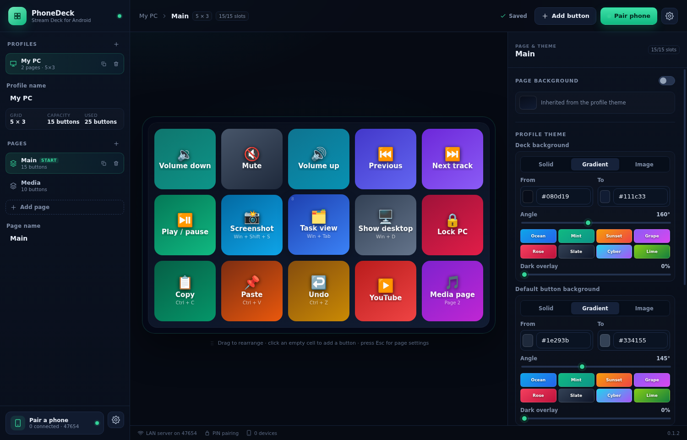
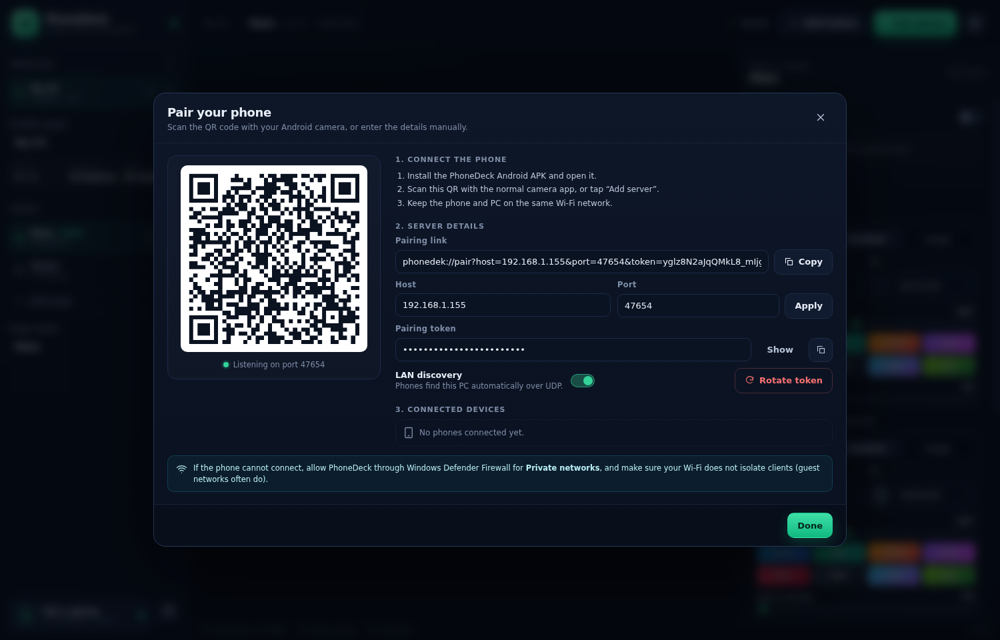
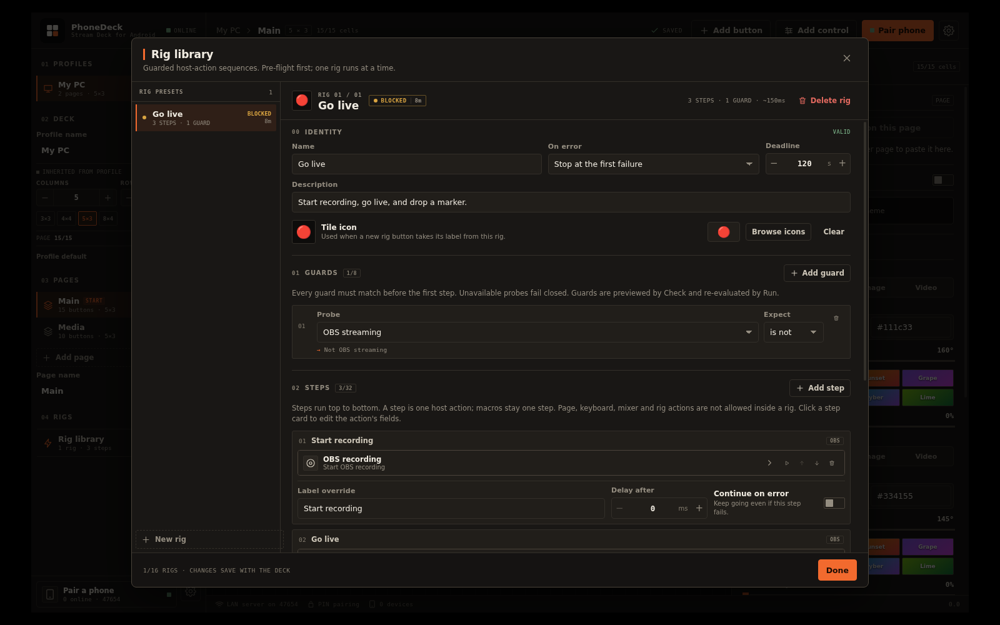
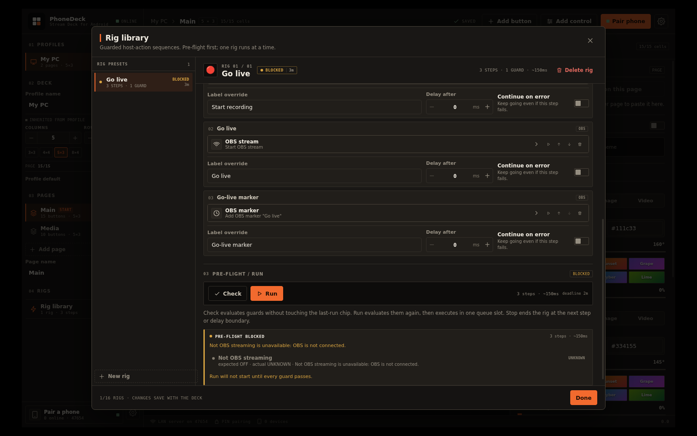
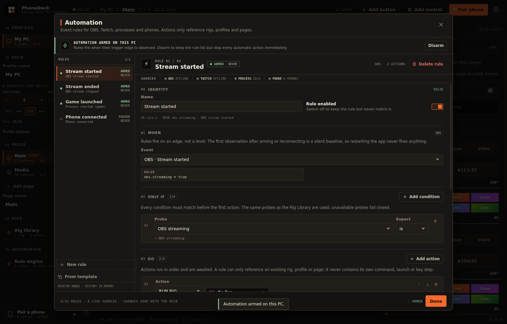
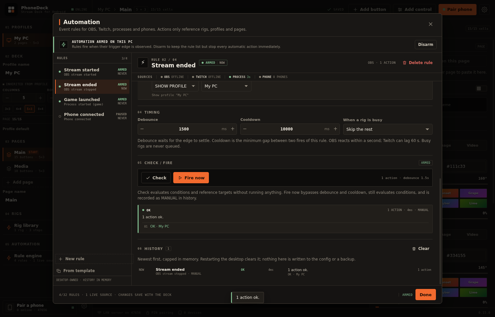
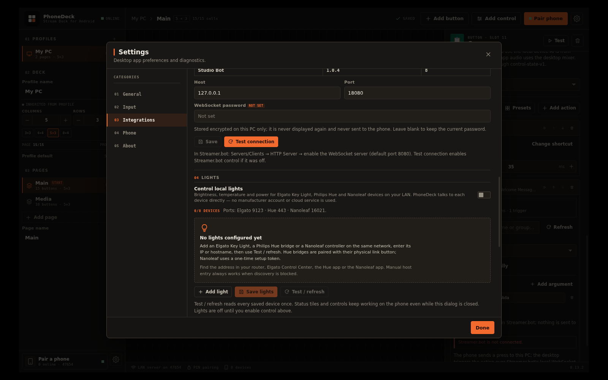

# PhoneDeck

[](https://github.com/Pelozo/phonedek/actions/workflows/build.yml)

**Turn an Android phone into a wireless Stream Deck for your Windows PC or Mac.**

PhoneDeck is two apps that work together:

| App | Platform | What it does |
| --- | --- | --- |
| **PhoneDeck Desktop** | Windows 10/11 · macOS 12+ Apple Silicon (unsigned preview) | Owns the configuration, hosts a LAN server, records macros, and executes shortcuts/app launches/commands on the computer. |
| **PhoneDeck Android** | Android 8+ (Kotlin/Compose) | Renders the deck fullscreen, pairs over Wi-Fi, sends presses, and handles page navigation instantly. |

No cloud, no account, no vendor lock-in: the phone talks directly to your PC over the local network.



<p align="center"></p>

```
┌──────────────────────────┐        Wi-Fi / LAN         ┌──────────────────────────┐
│  Android phone           │  HTTP config + WebSocket   │  Windows PC / Mac        │
│  - fullscreen deck       │ ◄────────────────────────► │  - deck editor           │
│  - QR pairing            │      button presses        │  - macro recorder        │
│  - offline config cache  │                            │  - action executor       │
└──────────────────────────┘                            └──────────────────────────┘
                                                                  │
                                                     SendInput / app launch /
                                                     URL / shell command
                                                                  ▼
                                                            Desktop apps
```

## Features

### Deck editor

- **Profiles and pages** — multiple PCs/layouts, up to 20 pages per profile, instant page switching.
- **Per-page grids** — 1×1 to 10×10 cells per page, with optional profile defaults; buttons snap to slots; drag to rearrange or swap. Change one page without touching the rest.
- **Buttons** — label, sublabel, 175 searchable emoji icons or your own, plus animated GIF/video media icons; solid/gradient/image/video backgrounds, dark overlay, custom text color, per-button radius.
- **Backgrounds** — curated gradients, color presets, or import PNG/JPG/WEBP/GIF/BMP (up to 25 MB) and MP4/WEBM/M4V/MOV video (up to 100 MB). Animated GIFs and videos play in the editor and on the phone.
- **Continuous controls** — absolute/relative volume sliders, volume wheels, and scroll wheels (vertical or horizontal, with Ctrl/Shift/Alt/Win modifiers for zoom and app-specific panes), microphone gain with tap-to-mute, OBS input volume/mute, per-app audio, media scrub, shortcut wheels and exact value entry, plus a trackpad tile (inline on the deck or a full-screen pad). Tiles honour spans and row spans.
- **Full-screen mixer** — one channel strip per live PC app with faders, percentages and mute.
- **Component clipboard** — `Ctrl/Cmd+C/X/V` copy, cut and paste a button or control, and **Move to…** sends it to any page or profile, keeping its settings and finding a free slot.
- **Live preview** — the editor canvas is the same grid the phone renders, including slots and overflow warnings.
- **Backups** — export/import a ZIP containing the config and every image/video asset; legacy JSON configs still import. **Export for older desktop** writes a valid JSON deck with rigs, automation rules and rig buttons removed.
- **Instant sync** — every saved change is pushed to connected phones over WebSocket.

### Actions

- **Shortcuts** — Ctrl+C, Cmd+Shift+3, Alt+Tab, media keys, F-keys, punctuation… labels and presets follow the host OS, so macOS shows Cmd/Option and Windows shows Win/Alt.
- **Preset packs** — Chrome, OBS Studio, VS Code, System and Media shortcuts, filterable and platform-aware.
- **Full-screen screenshots** — the Screenshot button captures the whole desktop directly to a PNG on Windows and macOS (no Snipping Tool), saved to the configured folder with a completion notification. Buttons imported from a macOS profile work on Windows too.
- **Macros** — record chords, typing, mouse clicks/double-clicks/drags/wheel and optional sampled movement; capture can run system-wide (outside PhoneDeck) with a `Ctrl/Cmd+Alt+F10` stop hotkey, or fall back to focused recording; choose whether pauses and text grouping are captured; repeat a macro 1–50× with a gap; edit/reorder/duplicate steps; launch/URL/command steps; keys can press, hold or release. Macro actions stay collapsed as one summary until you expand them.
- **Type text** — full Unicode text typed into the active window.
- **Launch applications** — pick an `.exe`, `.lnk`, `.bat` or `.cmd`, with arguments.
- **Open URLs** — http/https only.
- **Run commands** — run a command with your Windows user (clearly marked as trusted-only).
- **Media keys** — play/pause, next/prev, stop, volume up/down, mute.
- **Page navigation** — next/previous/goto, executed on the phone with no round-trip.
- Chain any number of actions on one button and test them from the editor.

### Rigs

- **Reusable action sequences** — Sidebar → **04 Rigs** holds up to 16 named rigs with 1–32 steps and up to 8 guards. A step can use any host action (shortcut, text, macro, launch/URL/command, OBS, Twitch, lights, audio/mic, per-app volume, Streamer.bot), with a 0–10 s delay and optional continue-on-error.
- **Guards and pre-flight** — guards run before step 1 (OBS streaming/recording, Twitch live, mic muted, app running, light on); unavailable or timed-out probes **fail closed**. **Check** previews the guard result, **Run** executes, and **Stop** aborts between steps.
- **Progress and truth** — one rig runs at a time; a second request returns `BUSY` with the active rig and progress. The button shows `RIG`, live `n/total`, then `OK`/`PARTIAL`/`FAILED`/`BLOCKED`/`STOPPED`/`TIMEOUT`; a status source keeps the last-run state (`READY`, `3/9`, `RUN 2m`, …) without claiming the world still matches.
- **Templates and reports** — Go live, BRB and Wrap start from safe generic steps; destructive steps ask for confirmation. Fail-fast is the default (continue mode reports `PARTIAL`), a configurable 120 s deadline stops before the next step, and nothing rolls back — the report identifies exactly where a run stopped.
- Rigs travel in backups and imports; command/launch steps inside rigs count toward the import risk total.





### Automation rules

- **Event triggers** — Sidebar → **05 Automation** holds up to 32 rules. WHEN triggers cover OBS streaming/recording/replay-buffer edges, OBS scene changes, Twitch live/offline, process start/stop (basename, no `.exe`) and phone connect/disconnect.
- **Conditions and actions** — ONLY IF reuses the rig guard vocabulary. Up to four ordered DO actions are references only: run a rig, show a profile, or show a page. A rule never contains its own key, launch or command action.
- **Test and history** — **Check** evaluates references and conditions without running anything; **FIRE NOW** skips timing but still checks conditions. History keeps the last 50 in-memory runs with status, failures and duration.
- **Phones optional** — rules keep running with zero phones connected; a phone that reconnects after an automation profile switch receives the chosen profile.
- **Safe by default** — automation is disarmed on every PC until **ARM AUTOMATION**; imports disarm it again. Triggers are edges, with debounce (1.5 s), per-rule cooldown (10 s), a 12/min storm brake and a 4 s settle window. See [Automation](#automation) for the safety model.





### App

- **What's New** — after a version change, desktop and Android show a one-time summary of what changed; a genuine first install stays quiet. **Settings → About → What's new** reopens the current summary at any time.
- **Categorized settings** — General, Input, Integrations, Phone and About, with update checks and log access under About.

### Pairing and networking

- **QR pairing** — scan with the normal camera app; the `phonedek://pair?...` deep link opens the app and connects.
- **LAN discovery** — desktop beacons over UDP; the phone lists available PCs automatically.
- **4-digit PIN auth** — every HTTP/WebSocket request needs the pairing PIN; generate a new PIN to revoke all phones. Wrong PINs are rate-limited.
- **Offline cache** — the phone keeps the last config and can render while the PC is asleep/offline.
- **Auto-reconnect** with backoff, heartbeat, and a clear connection status.
- **Live volume state** — absolute volume controls show the PC's actual level and follow external changes. Old desktops fall back to `LOCAL`.
- **Phone keyboard** — Add control/action opens a single full-screen QWERTY/symbol panel on the phone (no system IME and no special-key strip). Each key sends live down/up; Shift/Ctrl/Alt can be held or tapped to latch, Tab can be held, Backspace/arrows repeat while held, and FN adds F1–F12 while PASTE sends clipboard text. Settings → Input → **Allow keyboard control** is the master switch; typing goes to the active PC window and is never logged.
- **Media scrub** — live playhead/duration, title/artist, local drag preview and seek on release; playerctl (Linux), Spotify/Music (macOS), SMTC (Windows).
- **Auto-profile** — Settings → Integrations → Games maps an executable to a deck profile; the phone switches once when the game starts. Optionally return to a chosen profile after the game closes (5 s debounce, cancelled if another mapped game starts).
- **Microphone** — default capture-device gain and tap-to-mute, with live `MUTED` / `NO INPUT` state. Windows Core Audio, macOS input volume, Linux `pactl`.
- **Per-app audio** — app-volume sliders/actions/status plus the full-screen mixer. Windows Core Audio sessions, Linux `pactl` sink-inputs; macOS unsupported.
- **Default audio device (Windows, macOS, Linux)** — switch the PC’s default output or input from a deck button, or cycle a 2–8 device list (two devices make a toggle). Live current-device chip and active target; opaque ids with friendly-name fallback. Windows sets all three roles by default; macOS uses CoreAudio; Linux uses `pactl` (PulseAudio/PipeWire) and affects new streams. OBS/apps that pin their own device do not follow the OS default.
- **Twitch** — device-code connect, live/viewers/uptime/title/game status tiles, chat, markers and title/game actions. Tokens are encrypted by the OS secret store.
- **Stream lights** — Elgato Key Light, Philips Hue (link-button pairing) and Nanoleaf (token) brightness/temperature/power controls with live status.
- **OBS Studio** — connect to OBS 28+ WebSocket (Settings → Integrations → OBS Studio, password stored only on the PC), then add an OBS input volume tile (0–200%, 100% = 0 dB) with tap-to-mute and live state (`MUTED`, `NO OBS`, `NO INPUT`).
- **Streamer.bot** — Settings → Integrations → Streamer.bot connects to its local WebSocket server (password stored on the PC only) with live status, instance name and action count. Add a Streamer.bot action button, pick from the live searchable action list (or type an exact name while offline), pass up to 16 named arguments, and **Test action** from the editor.
- **Pointer safety** — Settings → Input has an **Allow pointer control** master switch; it releases held buttons and suspends cursor/click injection. Native approval dialogs suspend it automatically.
- **Trackpad** — one-finger move, tap/right-click, two-finger scroll and long-press drag-lock, with sensitivity, natural scroll and drag-lock options. Windows/macOS use relative injection; Linux needs X11 (Wayland is unsupported).



## Automation

Rigs and rules are the hands-off layer on top of the deck. A **rig** is a saved, ordered sequence of host actions with guards in front; a **rule** watches one event edge and runs a rig or switches a profile/page. Both live in the desktop (Sidebar → **04 Rigs** and **05 Automation**) and travel with the deck in backups and imports.

Safety is deliberate:

- **Automation is disarmed on every PC** until you press **ARM AUTOMATION**, and importing a deck disarms it again.
- Guards and rule conditions **fail closed** — a probe that is unavailable or times out blocks the action instead of guessing.
- **One rig runs at a time.** A second request is reported as busy; a rig occupies one executor slot, so ordinary presses queue behind it.
- Edges, not levels: the first observation after arming or reconnecting is a silent baseline. Debounce, per-rule cooldown, a storm brake and a settle window prevent loops.
- Nothing rolls back. Rig reports and rule history say exactly what ran, what failed and where it stopped.

## Compatibility

- Config schema stays **v1**. `rigs` and `rules` are additive; older phones ignore them and keep rendering the deck.
- An **older desktop** rejects a config containing rig actions (it treats the unknown action as corrupt). Use **Settings → Backup → Export for older desktop** to write a JSON deck with rigs, rules and rig buttons removed, then import that on the old PC.
- An older desktop **strips `rules` on its next save** instead of resetting the config, so automation is lost on downgrade. Export a backup before downgrading.
- Deleting a rig/profile/page in the editor removes matching rule actions and drops rules left with no actions. Hand-edited or imported configs with dangling references are still rejected rather than guessed at.
- Phones paired to a pre-0.13.2 desktop fall back to a chord-per-key keyboard instead of live key down/up.
- Default audio-device switching uses Windows Core Audio `IPolicyConfig`, macOS CoreAudio, and `pactl` on Linux. Bluetooth endpoints must be connected and appear active; OBS and apps pinned to a device keep their own route.

## Quick start (Windows)

> The easiest path is the [latest release](https://github.com/Pelozo/phonedek/releases/latest) or a GitHub Actions artifact. Every push builds a Windows installer, a macOS arm64 DMG/ZIP, and a debug APK.

1. Open the **Actions** tab → latest **Build** run → download:
   - `PhoneDeck-Windows` (installer `.exe`)
   - `PhoneDeck-macOS-arm64` (unsigned `.dmg` / `.zip`)
   - `PhoneDeck-Android` (`app-debug.apk`)
2. Run the installer. Windows SmartScreen may warn because the build is unsigned — choose **More info → Run anyway**.
3. Allow PhoneDeck through **Windows Defender Firewall** for **Private networks** when prompted.
4. Install the APK on Android (enable “Install unknown apps” for your file manager if needed).
5. In PhoneDeck Desktop press **Pair phone**. On Android, scan the QR with the camera app, or add the host/port/PIN manually.
6. Press a button. Done.

### Manual pairing

The desktop shows:

- host (for example `192.168.1.42`)
- port (`47654` by default)
- PIN (4 digits)
- pairing link / QR

The phone and PC must be on the same Wi-Fi. Guest networks with client isolation will not work.

## Build from source

### Desktop

Requirements: **Node.js 22+**, npm. Final apps: Windows 10/11 x64 or macOS 12+ Apple Silicon (unsigned arm64 DMG). Development also works on Linux for the UI; Linux key injection uses xdotool.

```bash
npm install
npm run dev        # Electron + Vite dev server
npm test           # shared + desktop core tests (Vitest)
npm run typecheck
npm run build
npm run dist:win   # NSIS installer in apps/desktop/release
```

On macOS, build the CGEvent helper before packaging: `npm run build:mac-helper -w @phonedek/desktop`, then `npm run dist:mac -w @phonedek/desktop`. The first app launch requires **Accessibility** permission; see [docs/MACOS.md](docs/MACOS.md).

On Linux, `npm install` may need a filesystem that supports `chmod` (avoid NTFS/FUSE mounts for `node_modules`).

After publishing a release, verify its assets with `scripts/verify-release.sh vX.Y.Z` (or add `apk` for a quick APK/feed check). It checks `SHA256SUMS`, the update feeds and the APK manifest version; set `AAPT2` if `aapt2` is not on `PATH`.

### Android

Requirements: JDK 17/21 + Android SDK 34 (platform + build-tools 34.0.0).

```bash
cd apps/android
./gradlew assembleDebug
adb install -r app/build/outputs/apk/debug/app-debug.apk
```

Or open `apps/android` in Android Studio and run it.

## Macro options

Macros are built from ordered steps:

- shortcut (press & release, hold down, or release)
- type text
- delay
- media key
- mouse click / double-click / hold / release / move / scroll
- launch app, open URL, run command

Recording options: capture pauses as delays, group typing into text steps (turn off for game inputs), pause/resume, undo the last step, repeat the macro up to 50× with a per-repeat delay. Mouse buttons, drags, wheel and optional movement are recorded as editable steps.

Global capture (Windows, macOS and Linux X11) uses a native input hook and records keystrokes and mouse activity in other apps. It is opt-in per recording, shows an OS notification, ignores input while a PhoneDeck window is focused, and stops with `Ctrl/Cmd+Alt+F10` (or the Stop button). If the hook cannot start (Wayland, missing permissions, native module failure) the recorder falls back to focused capture. macOS requires Accessibility and Input Monitoring permission; Windows cannot capture input aimed at elevated apps (UIPI). libuiohook does not expose an “injected” flag, so avoid triggering phone actions while recording, or they may appear as steps.

## How actions execute

The desktop keeps a persistent PowerShell helper (`resources/keyboard-helper.ps1`) that calls Win32 `SendInput`:

- chords are pressed/released in order,
- text is sent as Unicode (no clipboard pollution),
- media keys and mouse clicks use virtual-key/mouse events,
- `launch`, `url`, and `command` are executed by Electron's main process.

If the helper fails, the action result (and a hint) is shown on the phone and written to `phonedek.log` (Settings → Open logs).

The helper ships inside the app (no separate install or SDK) and uses C# constructs that also compile under Windows PowerShell 5.1. If PowerShell policy or antivirus blocks it, key/text/media buttons fail while URL/app/command actions keep working. Sending input to elevated windows requires running PhoneDeck as Administrator (Windows UIPI).

## Security model

PhoneDeck is a LAN tool, not an internet service.

- The HTTP/WebSocket server binds `0.0.0.0` and requires the 4-digit pairing PIN (rate-limited after 6 wrong attempts per minute).
- Discovery beacons contain only the server name and port — never the PIN.
- The QR code contains the PIN, so treat a screenshot of it like a password.
- **Run command** and **Launch app** actions execute with your Windows account. Only import configs you trust.
- **Rigs and automation** can trigger those actions without a press. Automation is disarmed by default on every PC and after every import; arm it only for decks you trust.
- **Global macro capture** sees keystrokes and mouse activity in every app while recording. It is explicitly started per recording, shows a native notification, uses a global stop hotkey and ignores PhoneDeck-focused input. Only record while you control the machine; stop it before leaving.
- Generate a new PIN in **Pair phone** to disconnect every phone immediately.
- There is no TLS: do not expose the port to the internet or to untrusted networks. Use a firewall rule limited to Private networks.

## Repository layout

```
apps/
  desktop/          Electron main + preload + React configurator
  android/          Kotlin + Jetpack Compose deck app
packages/
  shared/           Config model, Zod schema, action planner, macro recorder, tests
docs/
  PROTOCOL.md       HTTP + WebSocket + discovery + config contract
  ARCHITECTURE.md   Design notes
  WINDOWS.md        Build, firewall, packaging, troubleshooting
  ANDROID.md        Build/install/pairing notes
```

## Diagnostics

- **Android:** Settings → Diagnostics / logs (also available from the pairing screen) shows the last pairing/network events and has **Copy**. Or use `adb logcat -s PhoneDeck`.
- **Windows:** Settings → Open logs (`%APPDATA%\PhoneDeck\phonedek.log`).

## macOS (unsigned preview)

> **Long-term:** the seamless path is Developer ID signing + notarization; the
> build pipeline is ready for it (see [docs/MACOS.md](docs/MACOS.md)). Unsigned
> previews need a one-time permission step per build.

1. Download the `arm64.dmg` from the [latest release](https://github.com/Pelozo/phonedek/releases/latest) and drag PhoneDeck to **Applications**.
2. Gatekeeper: right-click the app → **Open**, or use **System Settings → Privacy & Security → Open Anyway**.
3. Grant **input control** for key/mouse actions. PhoneDeck shows a banner with a
   **Grant permission** button that opens the native macOS prompt. The pane is
   **System Settings → Privacy & Security → Accessibility**, renamed **Device
   Control and Data Access** on macOS 27. If the switch alone doesn't stick, add
   `/Applications/PhoneDeck.app/Contents/MacOS/PhoneDeck` as a file — Settings →
   Input permission has **Show app file** and **Copy** for it. Allow **Local
   Network** on macOS 15+ for pairing/discovery.
4. Pair with the 4-digit PIN or QR exactly like Windows.

The macOS build is unsigned and arm64-only; in-app auto-update is disabled there until Developer ID signing/notarization. See [docs/MACOS.md](docs/MACOS.md).

## Manual testing

A step-by-step checklist is in [docs/TESTING.md](docs/TESTING.md). The current preview is published at the [latest release](https://github.com/Pelozo/phonedek/releases/latest).

## Status

Early but usable. The core editor, protocol, action execution, Android rendering, pairing, rigs and automation rules are implemented.

## License

MIT © 2026 Pelozo
